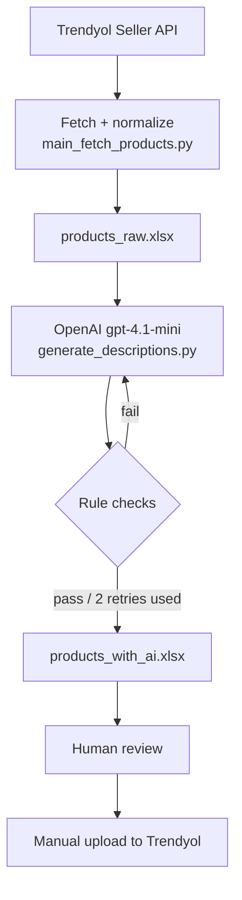

# Trendyol SEO Description Pipeline

Python pipeline that pulls a brand's product catalog from the Trendyol Seller API, writes a new SEO description for each product with the OpenAI API, checks every output against marketplace rules, and hands the results to a person for review in an Excel sheet. Nothing is published automatically.

Built during my LLM automation internship at [Skywalker.tc](https://skywalker.tc), where we produced content for brand catalogs on Trendyol.

## Pipeline



## Rule checks

Every generated description goes through `violates_rules()` in `services/ai_description.py`. A description fails if it:

- is empty,
- contains HTML (`<` or `>`),
- contains a banned phrase: `en iyi`, `%100`, `garanti`, `mucize`, `kesin`, `hastalık`, `tedavi`, `vaat`, `iddia`, `bedava`,
- is shorter than 100 words.

A failed description is regenerated up to two more times. If it still fails, it is kept with status `FAIL` so the reviewer can see it.

The prompt also tells the model to avoid medical and guaranteed-result claims, to write 120–160 words in three paragraphs, and to use no emoji or bullet points.

## Results from the internship run

One brand catalog, 36 products, processed in a single batch:

| Metric | Value |
| --- | --- |
| Products processed | 36 |
| Passed the rule checks | 36 / 36 |
| Original descriptions, average length | 40 words (5 of them were raw HTML) |
| Generated descriptions, average length | 118 words (range 101–138) |

These are automated checks only. Whether a description was good enough to publish was decided by a person. The output files contain client catalog data, so they are not in this repository.

## Run it

Requires Python 3.10+.

```bash
pip install -r requirements.txt
cp .env.example .env      # fill in your Trendyol and OpenAI credentials
python main_fetch_products.py              # writes outputs/products_raw.xlsx
python generate_descriptions.py --limit 1  # try one product first
python generate_descriptions.py            # whole catalog -> outputs/products_with_ai.xlsx
```

The review sheet keeps the original `description` next to `new_description` and `ai_status` (`OK` / `FAIL`).

## Second mode: CSV input with versioned HTML output (`app/`)

An earlier, separate variant for long-form product pages:

- reads products from `data/input_products.csv` instead of the API,
- stores products and every generation in SQLite (`app/models.py`), with a version number and a JSON validation report per attempt,
- asks the model for HTML using only `<strong>`, `<ul>`, `<li>`, `<br/>`, with a 25,000–27,000 character target,
- validates banned words from `data/banned_words.txt`, character count and repeated sentences (`app/validator.py`),
- falls back to a template-based stub generator (`app/generator_stub.py`) when the API call fails (auth, quota, rate limit, connection).

```bash
python -m app.pipeline --csv data/input_products.csv --limit 5
```

## Known gaps

- The prompt asks for 120–160 words, but the length check accepts anything from 100 words. The average output (118 words) is below the prompt's own target, so the check should be raised to match.
- Banned phrases are matched as plain substrings, so `kesin` also blocks `kesinlikle`. That was intentional for this catalog but would be too strict elsewhere.
- In `app/`, the stub fallback is silent and every generation is stored with `model_name="LLM"`, so template output cannot be told apart from model output in the database. The fallback should be logged and recorded as `stub`.
- In `app/validator.py` the repetition thresholds were loosened for testing with the stub generator (200 repeats, 1% unique sentences) and are effectively off.
- The two modes share no code, and neither has automated tests.

## Security

Credentials are read from environment variables (`.env`, see `.env.example`). Never put API keys in source files.
